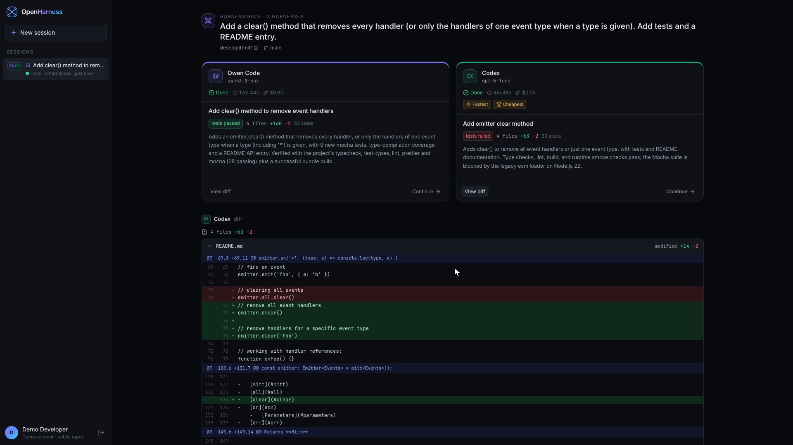
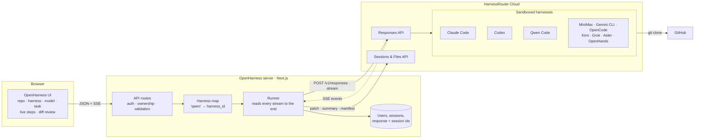
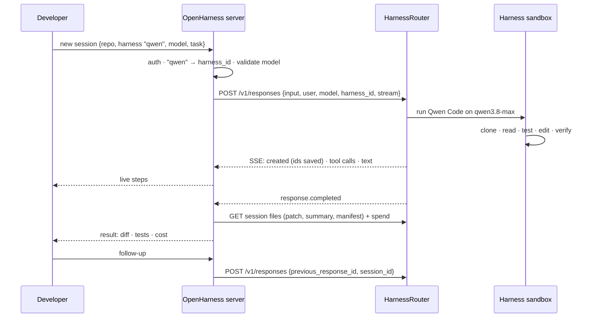
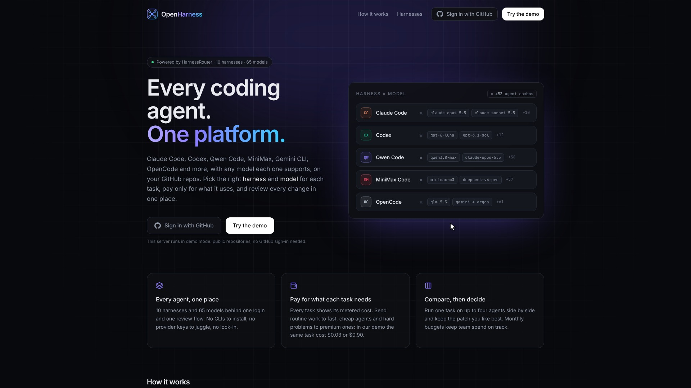
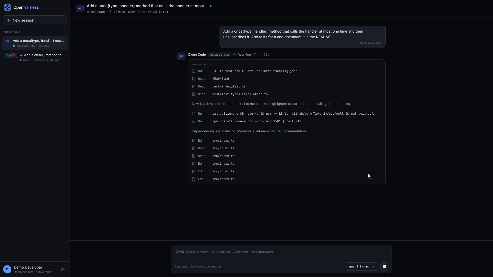
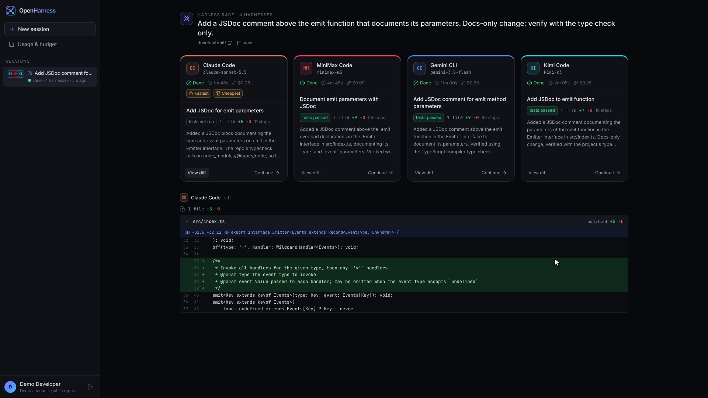
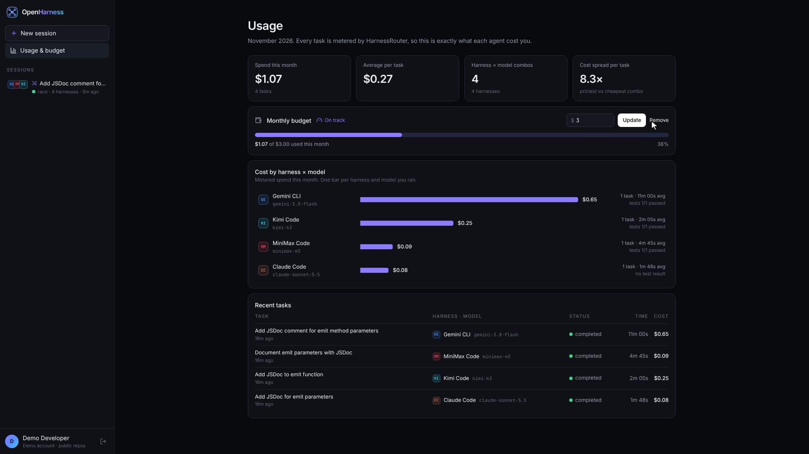

# OpenHarness

**Every coding agent. Any model. One platform.**

**OpenHarness is a harness- and model-agnostic coding platform: think Devin or Claude Code on the web, except you choose the agent.** Today AI coding agents are silos. Claude Code, Codex, Qwen Code, Gemini CLI and the rest are each a separate install, login and bill, each tied to one vendor's models, and none of them is the best or cheapest choice for every task. OpenHarness puts **10 agent harnesses and 65 models behind one web app**: connect a repo, pick the harness and the model (or run several side by side), watch the agent work live, and review a real diff with its test results and exact cost. Every task runs on **HarnessRouter**, which gives us sandboxed execution of every harness through one API, so a small hackathon team could ship a multi-agent coding platform in an afternoon.

🎬 **[Watch the 2:53 demo on YouTube](https://www.youtube.com/watch?v=vqSH4NsfjX4).** Everything in it is the real app running real tasks: real repos, real diffs, real costs. (Also in the repo: [`demo/openharness-demo.mp4`](demo/openharness-demo.mp4).)

[](https://www.youtube.com/watch?v=vqSH4NsfjX4)

📓 **[Build log and feedback for HarnessRouter](buildlog.md):** the timeline, our decisions, every HarnessRouter API we used, a task ledger reconciled to HarnessRouter's own spend ($5.33 total), and specific product feedback.

## The pitch in numbers

All from real runs in the demo, on the open-source [`developit/mitt`](https://github.com/developit/mitt) repo:

| | |
|---|---|
| **Choice** | 10 harnesses × 65 models = **453 agent combinations**, read live from HarnessRouter |
| **Cost** | Same task, two agents: **Codex + `gpt-6-luna`: $0.03, 4m 48s** vs **Qwen Code + `qwen3.8-max`: $0.90, 12m 44s, all 28 tests passing**. That's a **27× price spread**: route routine work to cheap agents and save premium ones for the hard problems. |
| **Quality** | Qwen Code + `qwen3.8-max` added `once()` to mitt with **10 new tests, all passing**, plus docs, for $1.20. A follow-up question was answered from the same session's context in 63 s for $0.15. |
| **Visibility** | Four agents, one docs task: **$0.08 (Claude Code) to $0.65 (Gemini CLI), an 8× spread**, metered per task on the Usage page, with a monthly budget the server enforces |
| **Breadth** | **All 10 harnesses verified** on real tasks (37–57 s, $0.01–$0.13 each for a code question) |
| **Integration** | **One API** for all of it: HarnessRouter's Responses API |



## Sponsors used

| Sponsor | Role in OpenHarness | HarnessRouter APIs used |
|---|---|---|
| **HarnessRouter** | The entire agent runtime: every task, on every harness and model, runs on HarnessRouter Cloud | Harnesses (create, reuse by name, ETag/If-Match updates) · Responses (streaming, per-task model, follow-ups, idempotency, cancel, recovery by polling) · Sessions & container files · Catalog (`/v1/bases`, `/v1/harnesses/{id}/models`) · File uploads · UHP discovery |

<sub>Not a sponsor, just tooling: the demo's voiceover was made with ElevenLabs.</sub>

## HarnessRouter, in detail

### Why it's the foundation

Without HarnessRouter, a multi-agent coding platform means hosting and sandboxing ten different agent CLIs, keeping up with their releases, managing keys and billing for a dozen model providers, and normalizing ten different tool vocabularies and output formats. With HarnessRouter it is one `POST /v1/responses` with a `harness_id` and a `model`. **When the next great harness ships, adding it is a config entry for us and zero work for our users.**

### 1. Harnesses: one per agent base

A harness's `base` is fixed, but its model can be chosen per task. So OpenHarness owns **ten HarnessRouter harnesses**, one per agent base, all sharing one set of standing instructions ([`harness/instructions.md`](harness/instructions.md)). Every task then sends the user's model choice.

| Harness | Base | Default model | Harness ID |
|---|---|---|---|
| OpenHarness · Claude Code | `claude-code` | `claude-sonnet-5.5` | `chrn_c47330db15764363823f048d4e46e9f2` |
| OpenHarness · Codex | `codex` | `gpt-6.1-sol` | `chrn_f5ace330e5e64767a9cd825ec40320a0` |
| OpenHarness · Qwen Code | `qwen` | `qwen3.8-max` | `chrn_08682317001646f181ca74a7b44e4b4f` |
| OpenHarness · MiniMax Code | `minimax` | `minimax-m3` | `chrn_d06549c02dff49f4a0cd0eeb91afefe5` |
| OpenHarness · Gemini CLI | `gemini` | `gemini-3.8-flash` | `chrn_5827c761f5084e189154a6003c9b9012` |
| OpenHarness · OpenCode | `opencode` | `gpt-6.1-sol` | `chrn_35b060ef3aff468dbdce0ab3d538f252` |
| OpenHarness · Kimi Code | `kimi` | `kimi-k3` | `chrn_2933c7ca642440f78d3d70c1bab68ebf` |
| OpenHarness · Grok Build | `grok` | `grok-4.6` | `chrn_ff4c701612414893956d5a5c07e28fc1` |
| OpenHarness · Aider | `aider` | `gpt-6.1-sol` | `chrn_99cee88d96ac4e7e8353c3f2f4b8ec33` |
| OpenHarness · OpenHands | `openhands` | `gpt-5.4` | `chrn_f2da6c4bd2ab45e3b707e699fe6f1994` |

* **One output contract for every harness.** The instructions make every agent hand back the same artifacts: `out/changes.patch` (the cumulative diff against the starting commit), `out/SUMMARY.md` and `out/manifest.json` (title, summary, changed files, test status). That's what makes ten very different agents comparable side by side.
* **Managed as code.** [`harness/setups.json`](harness/setups.json) is the source of truth. `npm run hr:ensure` reuses harnesses by exact name or creates them. `npm run hr:sync` fetches each live harness with its ETag, applies a full `PUT` with `If-Match`, retries on `412` and reads it back. The live copy is [`harnessrouter.json`](harnessrouter.json).
* **Budgets per task:** 250 steps, 50 minutes, $3.

### 2. Responses API: every task

```jsonc
// POST https://api.harnessrouter.ai/v1/responses   (server-side, Authorization: Bearer $HR_API_KEY)
{
  "input": "Repository: https://github.com/developit/mitt.git\nBranch: main\n\nTask:\nAdd a once() method…",
  "user": "u_…",                          // the signed-in OpenHarness user, set by the server
  "model": "qwen3.8-max",                  // the user's model choice, validated per harness
  "metadata": { "harness_id": "chrn_…" },  // mapped server-side from the harness the user picked
  "stream": true
}
```

* **Streaming.** The server consumes the SSE stream and turns tool calls into small sanitized steps (`Run npm test`, `Edit src/index.ts`) that it fans out to the browser. The stream is read to the end even if the user closes the tab.
* **Durability.** `response.id` and `session_id` are saved at `response.created`. After a restart, the server polls `GET /v1/responses/{id}` and never re-sends the task. Each new task carries a fresh `Idempotency-Key`.
* **Follow-ups.** These send `previous_response_id` plus `metadata.session_id`, always on the harness the session started on, so the agent keeps its full context. Users can switch models mid-session.
* **Cancel:** `POST /v1/responses/{id}/cancel`.

### 3. Sessions and files

When a task ends, the server lists `GET /v1/sessions/{id}/files`, downloads the `out/` deliverables with the key, and turns them into the result card: diff viewer, `SUMMARY.md`, test status and a downloadable patch. The session's `spend_usd` becomes the **per-task cost shown to the user**. That's the number behind the cost story: it feeds the **Usage page** (spend by harness × model) and the **monthly budget**, which the server enforces before starting any task, side-by-side run or follow-up (HTTP 402 once the cap is reached).

### 4. Catalog

`GET /v1/bases` and `GET /v1/harnesses/{id}/models` drive the live model menus: 60 models on Qwen Code, 63 on OpenCode, and so on. The server re-validates the chosen model against them on every task.

### 5. File uploads

For private repos (GitHub sign-in), the server downloads the tarball with the user's GitHub token and uploads it with `POST /v1/files` as an `input_file`, so **the agent never sees a GitHub token**. Public repos are cloned inside the sandbox.

### 6. Security, by HarnessRouter's own rules

* The HarnessRouter key lives only in the server environment.
* `harness_id`s, session and response ids, download URLs and raw upstream errors never reach the browser. The browser only sends a harness *key* like `"qwen"`.
* Every session, stream, download, follow-up and cancel route checks ownership. Cross-site POSTs are refused.
* We verified that production build traces exclude `.env*` and user data.

## Architecture



One task, end to end:



## Product tour

| | |
|---|---|
|  |  |
| **Every coding agent, one platform.** | **Pick any harness × model.** 10 harnesses, 65 models, one composer. |
|  |  |
| **Watch it work.** Every command and edit streams in live. | **Review like a PR.** Summary, test status, full diff, exact cost, then follow up in the same session. |
|  |  |
| **Run agents side by side.** Claude Code, MiniMax, Gemini CLI and Kimi on the same change. | **Usage & budgets.** Spend per harness × model, metered by HarnessRouter, with a monthly cap. |

## Why it's a business

* **Who pays:** developers and teams who already pay for several coding agents and still switch between them.
* **What they get:** **options** (the right harness and model for each task, never locked in), **lower cost** (cheap agents for routine work, premium ones only when needed: a 27× spread on the same task in our demo) and **one platform** (one login, one bill, one review flow for every agent).
* **How we make money:** pay-per-task credits with a margin on top of each HarnessRouter run, and team plans with spend budgets (already built and enforced), harness and model policies, shared sessions, SSO and audit.
* **The moat:** every task records time, cost and test outcomes per repo × harness × model. That data powers **Auto mode** (next): routing each task to the best harness and model for its budget, and per-codebase leaderboards no single-vendor agent can offer.
* **Why HarnessRouter wins too:** every OpenHarness task is a HarnessRouter task. It's a consumer product that turns their API into end-user revenue, and it gets better every time HarnessRouter adds a harness.

## What's built vs. next

| Built and verified | Next |
|---|---|
| 10 harnesses × 65 models, live catalog | **Auto mode**: pick the harness and model per task and budget |
| Live streaming sessions, follow-ups, mid-session model switch | Open the reviewed patch as a GitHub PR (GitHub App, issue → PR) |
| Side-by-side runs with time, cost and test comparison | Billing (credits), team plans and harness/model policies |
| **Usage & budgets**: metered cost per harness × model, monthly budget enforced server-side | |
| Diff review, `SUMMARY.md`, patch download | Per-repo leaderboards from recorded outcomes |
| GitHub OAuth (needs an OAuth app; the demo runs in demo mode on public repos) | Postgres instead of the JSON store |
| Crash recovery, tenancy checks, idempotency, cancel | |

## Try it

```bash
npm install
```

Put a HarnessRouter key in the server environment as `HR_API_KEY`, or in a one-line, git-ignored `.env.harnessrouter` file. Then:

```bash
npm run dev
```

Open http://localhost:3000 and click **Try the demo**. For GitHub sign-in, set `GITHUB_CLIENT_ID`, `GITHUB_CLIENT_SECRET` and `APP_URL` (see [`.env.example`](.env.example)). To run the tests (adapter, stream parser, step builder, diff parser):

```bash
npm test
```

## Repo map

```
src/app/            landing, /app (composer), /app/s/[id] (session), /app/compare/[id] (side by side), API routes
src/lib/server/     HarnessRouter adapter, runner (stream → steps → SSE), catalog, auth, GitHub, store
src/lib/shared/     browser-safe types, harness metadata, diff parser
harness/            harness instructions + setups (source of truth for hr:ensure / hr:sync)
scripts/            hr-admin.mjs (harness admin), hr-smoke.mjs (one-off smoke test)
demo/               the video pipeline: narration, real-footage recorder, animated cards, ffmpeg assembly
buildlog.md         how we built it, the task ledger, and our feedback for HarnessRouter
```
