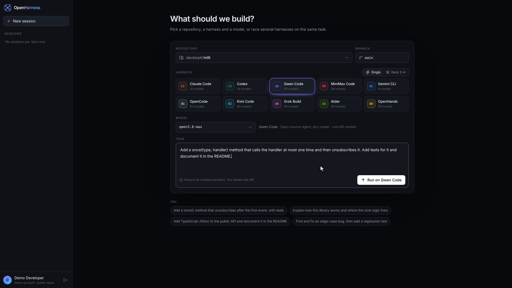
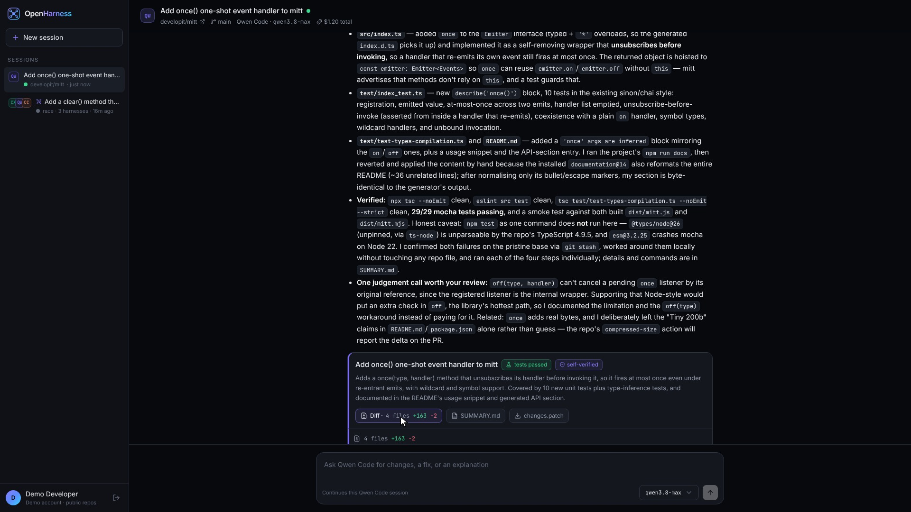

# OpenHarness

**One coding agent. Every harness.**

OpenCode made the *model* swappable. OpenHarness makes the *harness* swappable too. It's a web coding agent (think Claude Code on the web) where you pick the **agent harness** as well as the model: Claude Code, Codex, Qwen Code, MiniMax Code, Gemini CLI, OpenCode, Kimi Code, Grok Build, Aider and OpenHands. Point it at a GitHub repo, describe a task, watch the harness work live, review the diff, follow up, or **race several harnesses on the same task**.

Built for the HarnessRouter hackathon. [HarnessRouter](https://harnessrouter.ai) runs every agent; OpenHarness owns the product: sign-in, repos, sessions, the live UI and the review flow.

🎬 **Demo video:** [`demo/openharness-demo.mp4`](demo/openharness-demo.mp4) (3 min)



## What you can do

| | |
|---|---|
| **Pick harness × model** | 10 harnesses, 65 distinct models, 453 harness × model combinations, read live from HarnessRouter. Run Qwen Code on `qwen3.8-max`, Codex on `gpt-6-luna`, or Qwen Code on Claude, all from one picker. |
| **Watch it work** | Every command, edit and note the harness makes streams into the session as it happens. |
| **Review, not trust** | Each task ends with a reviewable result: title, summary, test status, a full diff viewer, `SUMMARY.md` and a downloadable `changes.patch`, plus time and real cost. |
| **Follow up** | Messages continue the same HarnessRouter session (`previous_response_id`), so the harness keeps its full context. You can switch models mid-session; the harness stays fixed. |
| **Race harnesses** | Send one task to 2–4 harnesses at once and compare time, cost, tests and diffs side by side, with *Fastest* and *Cheapest* badges. Continue with the winner. |
| **Sessions** | Every session (and its HarnessRouter response/session ids) is stored with your account, so you can come back to it. |



## How it works

```
Browser (React)                 OpenHarness server (Next.js, Node)                 HarnessRouter Cloud
───────────────                 ─────────────────────────────────                 ───────────────────
pick repo / harness / model ──► auth · tenancy checks · repo access          ──► POST /v1/responses  (stream: true)
live steps (SSE)            ◄── harness key → harness_id (server-only)            input, user, model,
diff / summary / download   ◄── consumes the stream even if the tab closes        metadata.harness_id
                                saves response.id + session_id per user       ◄── SSE events
                                reads out/changes.patch, manifest, SUMMARY    ◄── GET /v1/sessions/{id}/files
                                recovers running tasks after a restart        ◄── GET /v1/responses/{id}
```

* **One HarnessRouter harness per agent base.** A harness's `base` is fixed at creation, but its `model` can be overridden per task, so OpenHarness owns ten harnesses (`OpenHarness · Claude Code`, `OpenHarness · Codex`, …) that share one set of instructions, and sends the user's model choice as `model` on each task. The live config is in [`harnessrouter.json`](harnessrouter.json); the source of truth is [`harness/`](harness/).
* **The browser never sees HarnessRouter.** It sends a harness *key* (`"qwen"`), a model, a repo and a prompt. The server maps the key to the `harness_id`, validates the model against the harness's live model list, and calls HarnessRouter with `HR_API_KEY` from its own environment. Harness ids, session ids, response ids, download URLs and raw upstream errors never reach the browser.
* **One user request = one task.** A new session sends `input` + `user` + `metadata.harness_id`. A follow-up adds `previous_response_id` and `metadata.session_id` from the stored record, always on the harness the session started on.
* **Streams are consumed server-side**, independent of the browser connection, and turned into small sanitized "steps" (`Run npm test`, `Edit src/index.ts`) that are fanned out to the browser over Server-Sent Events. If the server restarts mid-task, recovery polls `GET /v1/responses/{id}` and never re-sends the task.
* **The output contract** (in the harness instructions) makes every harness hand back the same artifacts: `out/changes.patch` (cumulative diff against the starting commit), `out/SUMMARY.md` and `out/manifest.json` (title, summary, changed files, test status). The server downloads them with the key and serves them through owner-checked routes.
* **Repos:** public repos are cloned by the agent inside its sandbox. For private repos (GitHub sign-in), the server downloads the tarball with the user's token and uploads it to HarnessRouter as an input file, so the agent never sees a GitHub token.

### The harnesses

| Harness | Base | Default model | Harness ID |
|---|---|---|---|
| OpenHarness · Claude Code | `claude-code` | `claude-sonnet-5.5` | `chrn_c47330db15764363823f048d4e46e9f2` |
| OpenHarness · Codex | `codex` | `gpt-6.1-sol` | `chrn_f5ace330e5e64767a9cd825ec40320a0` |
| OpenHarness · Qwen Code | `qwen` | `qwen3.8-max` | `chrn_08682317001646f181ca74a7b44e4b4f` |
| OpenHarness · MiniMax Code | `minimax` | `minimax-m3` | `chrn_d06549c02dff49f4a0cd0eeb91afefe5` |
| OpenHarness · Gemini CLI | `gemini` | `gemini-3.8-flash` | `chrn_5827c761f5084e189154a6003c9b9012` |
| OpenHarness · OpenCode | `opencode` | `gpt-6.1-sol` | `chrn_35b060ef3aff468dbdce0ab3d538f252` |
| OpenHarness · Kimi Code | `kimi` | `kimi-k3` | `chrn_2933c7ca642440f78d3d70c1bab68ebf` |
| OpenHarness · Grok Build | `grok` | `grok-4.6` | `chrn_ff4c701612414893956d5a5c07e28fc1` |
| OpenHarness · Aider | `aider` | `gpt-6.1-sol` | `chrn_99cee88d96ac4e7e8353c3f2f4b8ec33` |
| OpenHarness · OpenHands | `openhands` | `gpt-5.4` | `chrn_f2da6c4bd2ab45e3b707e699fe6f1994` |

Budgets per task: 250 steps, 50 minutes, $3.

## Run it

Requires Node 22.18+.

```bash
npm install
```

Put your HarnessRouter key in the server environment as `HR_API_KEY`, or locally in a one-line, git-ignored `.env.harnessrouter` file (`HR_API_KEY=sk-hr-...`). Never commit it and never expose it to the browser.

```bash
npm run dev
```

Open http://localhost:3000 and click **Try the demo** (public repos, no GitHub needed).

**GitHub sign-in (optional):** create a GitHub OAuth app with callback `<APP_URL>/api/auth/github/callback`, then set `GITHUB_CLIENT_ID`, `GITHUB_CLIENT_SECRET` and `APP_URL` (see [`.env.example`](.env.example)). Users can then sign in with GitHub and pick from their own repos, private ones included.

### Managing the harnesses

```bash
npm run hr:me       # which HarnessRouter Workspace the key acts in
npm run hr:ensure   # reuse-by-exact-name or create every harness in harness/setups.json → harnessrouter.json
npm run hr:sync     # fetch live (ETag) → full PUT with If-Match → read back; for instruction/model changes
```

To change the instructions, edit [`harness/instructions.md`](harness/instructions.md) and run `npm run hr:sync`. It starts from the live record (which may have been edited in the HarnessRouter console), sends `If-Match`, refetches on `412`, and rewrites `harnessrouter.json`.

### Tests

```bash
npm test        # stream parser, adapter (key/idempotency/user/model/follow-up/poll recovery), step builder, diff parser
npm run build   # type-checks and builds
```

## Verified end to end

Through the app's own routes, with real HarnessRouter tasks:

* **Qwen Code + `qwen3.8-max` on `developit/mitt`:** "Add a `once()` method with tests and docs" completed with 4 files changed (+197 −3), 12 new tests, 31 passing, the patch/summary/manifest collected, and $1.47 of real spend.
* **Crash recovery:** the dev server restarted mid-task. On the next request, the server found the running turn, polled `GET /v1/responses/{id}` to completion and collected the outputs without re-sending the task.
* **Follow-up:** continued the same session with `previous_response_id` and the model switched to `qwen3.8-flash`. The harness answered from its earlier context in 20s.
* **All ten harnesses run:** besides Qwen Code, Codex (`gpt-6-luna`, in the race) and Claude Code (`claude-haiku-5.5` probe), MiniMax Code, Gemini CLI, OpenCode, Kimi Code, Grok Build, Aider and OpenHands each completed a real task on their default models in 37–57 s for $0.01–$0.13.
* **Tenancy:** a second user gets 404 on another user's session detail, stream, downloads, follow-ups and cancel, and their session list is empty. Cross-site POSTs are refused. Unknown models are refused.
* **No leaks:** browser payloads contain no `chrn_`/`hsess`/`resp_` ids, download URLs or keys. Server build traces exclude `.env*` and `.data/`.

## Hackathon scope

* **Storage** is a JSON file (`.data/db.json`) behind a tiny repository layer. Swap in Postgres for multi-instance deploys.
* **GitHub sign-in** is fully wired (OAuth, repo listing, private-repo tarballs) but needs an OAuth app. The demo runs in demo mode on public repos.
* **Opening a pull request** from the reviewed patch is the obvious next step. The agent is told never to push; the server would apply `changes.patch` with the user's token.

## Project layout

```
src/app/                 pages (landing, /app composer, /app/s/[id] session, /app/compare/[id] race) + API routes
src/lib/server/          server-only: HarnessRouter adapter, runner (stream → steps → SSE), auth, GitHub, store
src/lib/shared/          browser-safe types, harness metadata, diff parser
src/components/          UI
harness/                 harness instructions + setups (source of truth for hr:ensure / hr:sync)
harnessrouter.json       live harness ids, names, bases, models, instructions (no secrets)
scripts/                 hr-admin.mjs (harness admin), hr-smoke.mjs (one-off smoke test)
demo/                    the demo video pipeline: narration (ElevenLabs), real recordings (Playwright), assembly (ffmpeg)
```
